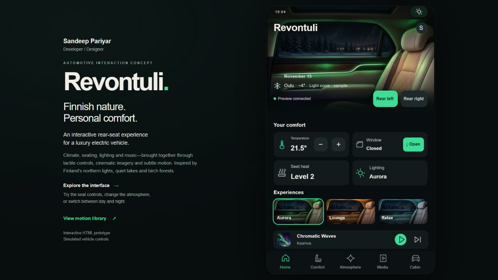

# Revontuli — Interactive EV Cabin & Embedded UI Demo

Sandeep Pariyar · Developer / Designer

**[Launch the live demo →](https://sandeepariyar.github.io/revontuli-embedded-ui-demo/compare/)** · No installation required

Explore Home, Comfort, Atmosphere, Media and Cabin in the approved HTML design and the LVGL + C++ implementation. The LVGL build runs locally in the browser through WebAssembly. Both interfaces simulate vehicle state.

The portfolio demonstrates the native rendering path and the use of reusable raster assets for embedded constraints. The published asset and binary sizes are measured. The target buffer sizes are estimates. Firmware fit and physical performance require a board build and hardware verification. A Qt Quick Ultralite source study is included.

GitHub Pages publishes `docs/` from main. See `source/lvgl/README.md` for build instructions. The approved design is also available at `docs/design/`.
