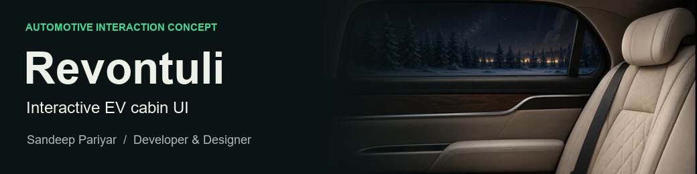
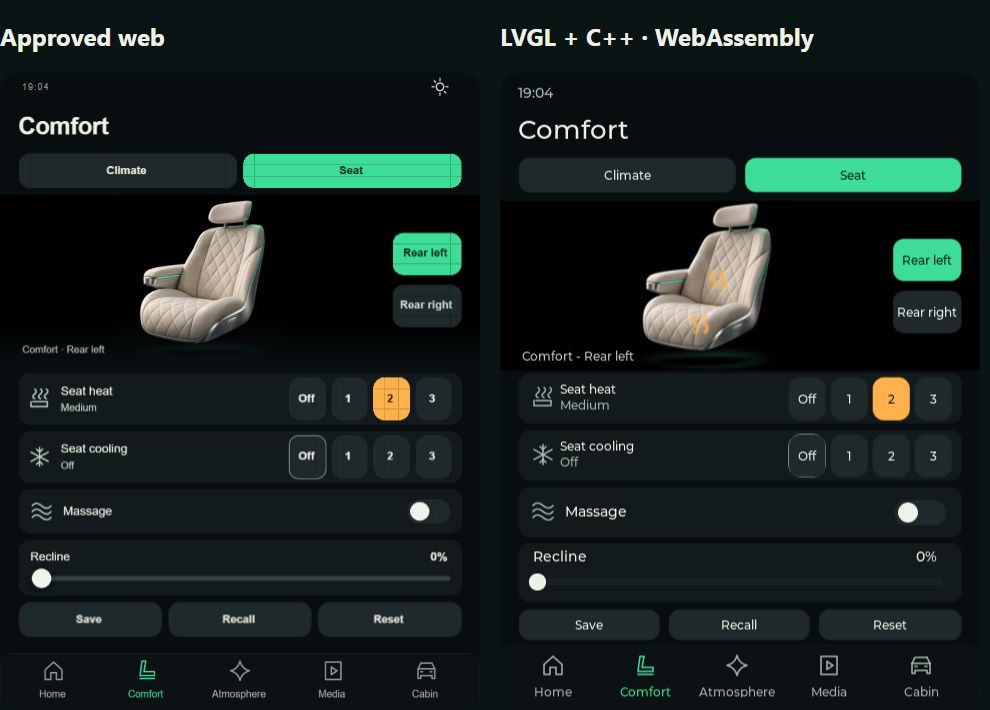

# Revontuli — Interactive EV Cabin UI

A rear-seat touchscreen concept for a luxury EV, inspired by Finnish winter light. Explore the original design next to a working **LVGL + C++** implementation, both running in your browser.

[Web design and LVGL + C++ side by side](https://sandeepariyar.github.io/revontuli-embedded-ui-demo/compare/) · No installation required

*Comfort → Seat. Original web design on the left, LVGL rendering with a C++ controller on the right.*

## Try it

- In **Comfort → Seat**, choose Cooling 2, toggle massage, and switch rear seats.
- In **Comfort → Climate**, compare Face, Body, and Feet airflow at different fan speeds.
- In **Cabin**, open a rear window, stop it midway, then close both rear windows.

Home, Atmosphere, and Media are also available. Each implementation maintains its own simulated state.

## How it was built

The original interface uses HTML, CSS, and JavaScript. The embedded UI study uses LVGL widgets and a shared C++ controller compiled to WebAssembly. It reuses the cabin artwork, PNG icons, and button skins, with cropped image sequences for motion. A Qt Quick Ultralite source study is also included.

| Resource | Size |
| --- | ---: |
| Browser asset pack, measured | 4.43 MiB |
| Browser WebAssembly binary, measured | 443 KiB |
| 480 × 40 RGB565 partial draw buffer, estimated | 37.5 KiB |
| 480 × 638 RGB565 full framebuffer, estimated | 598.1 KiB |

The buffer estimates cover pixel storage only. Image decoding, fonts, caches, and application state add to runtime memory. Firmware fit, touch latency, and frame rate need verification on a selected board.

## Design reference

[Explore the original design](https://sandeepariyar.github.io/revontuli-embedded-ui-demo/design/) · [Inspect the C++ seat controller](https://sandeepariyar.github.io/revontuli-embedded-ui-demo/seat/) · [LVGL build instructions](source/lvgl/README.md)
